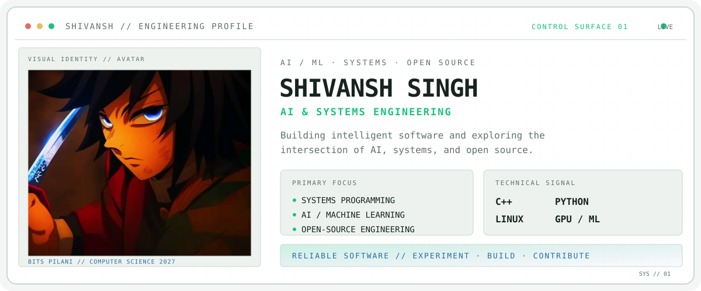
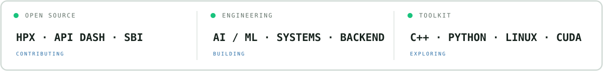

 <picture>
  <source media="(prefers-color-scheme: dark)" srcset="./assets/profile-system-dark.svg">
  <source media="(prefers-color-scheme: light)" srcset="./assets/profile-system-light.svg">
  
</picture>

  <b>Building intelligent systems. Exploring low-level engineering. Contributing to open source.</b>

  

<picture>
  <source media="(prefers-color-scheme: dark)" srcset="./assets/proof-strip-dark.svg">
  <source media="(prefers-color-scheme: light)" srcset="./assets/proof-strip-light.svg">
  
</picture>

 

<picture>
  <source media="(prefers-color-scheme: dark)" srcset="https://raw.githubusercontent.com/shivansh023023/shivansh023023/output/github-contribution-grid-snake-dark.svg">
  <source media="(prefers-color-scheme: light)" srcset="https://raw.githubusercontent.com/shivansh023023/shivansh023023/output/github-contribution-grid-snake.svg">
  
</picture>

## `01` // CURRENT FOCUS

- Systems programming and C++ engineering
- AI/ML engineering and LLM systems
- GPU computing and performance optimization
- Algorithmic trading and quantitative research
- Backend engineering and distributed systems

## `02` // OPEN SOURCE

Actively exploring and contributing to open-source ecosystems.

- **HPX** — C++ parallelism and distributed computing
- **API Dash** — API development and tooling
- **Meshery** — Cloud-native infrastructure and Kubernetes
- **SBI** — Scientific computing and simulation

Also explored AI projects involving NVIDIA NeMo and Google DeepMind OpenSpiel.

## `03` // SELECTED PROJECTS

| Project | Focus |
|---|---|
| AI Personal Assistant (JARVIS) | AI assistants and automation |
| Algorithmic Trading Bot | Quantitative research and trading systems |
| KnowledgeHub AI | AI-powered knowledge management |
| NanoNemotron | Local speech recognition and model quantization |
| TaskBoard | Docker, Kubernetes and CI/CD |
| Scene Classification | Deep learning and computer vision |

## `04` // TECHNICAL ARSENAL

**Languages**

Python · C++ · Java · Go · JavaScript · TypeScript · SQL

**AI / Machine Learning**

PyTorch · TensorFlow · Scikit-learn · FastAPI · NVIDIA NeMo · LLMs

**Systems & Infrastructure**

Linux · Docker · Kubernetes · Git · GitHub Actions · CUDA

**Backend & Databases**

FastAPI · Flask · Node.js · React · Next.js · MongoDB · PostgreSQL

## `05` // GITHUB ANALYTICS

  
  

## `06` // CONNECT

  <a href="https://www.linkedin.com/in/shivanshsingh23/">LinkedIn</a>
  &nbsp; · &nbsp;
  <a href="mailto:singhshivansh023@gmail.com">Email</a>
  &nbsp; · &nbsp;
  <a href="https://leetcode.com/u/Shivansh_2309/">LeetCode</a>

  <i>Build. Break. Understand. Improve.</i>

